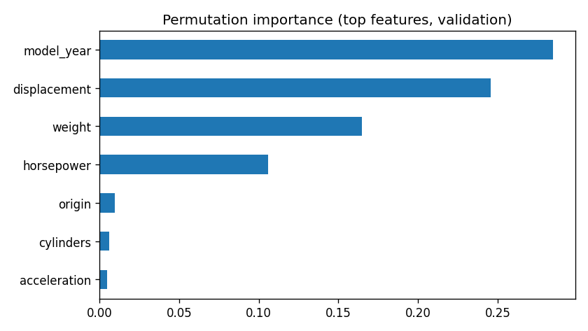

# ML Pipeline Template (AIPI 510 – Week 12)

A config-driven ML pipeline for tabular data: clean and split raw data, train, evaluate, version
and monitor. Currently configured for the Auto MPG dataset. The Results block below is rewritten
after every training run.

## Results

Accuracy is reported on the held-out **test** split. This is a regression task, so there is no
class accuracy: **R²** (share of variance in `mpg` explained) is the headline score, with RMSE and
MAE in mpg. Classification datasets report accuracy instead.

<!-- RESULTS:START -->
**Test R² = 0.8925** (89.3% of the variance in `mpg` explained) | RMSE 2.66 `mpg` | MAE 1.73 `mpg`

`random_forest` (regression) | run `20261113T164628Z` | commit `6cf8774` | rows train/val/test: 278/60/60 | features: 7

| Metric | Validation | Test | Baseline (test) |
|---|---|---|---|
| r2 | 0.8828 | 0.8925 | -0.0003 |
| rmse | 2.3984 | 2.6573 | 8.1066 |
| mae | 1.8211 | 1.7306 | 6.7100 |



<!-- RESULTS:END -->

## Dataset

**Auto MPG** (UCI / StatLib): 398 cars, model years 1970–1982. Predict fuel economy (`mpg`,
regression) from cylinders, displacement, horsepower, weight, acceleration, model year and origin.
Details: [data/README.md](data/README.md).

## Quick start

```bash
python -m venv .venv
.venv\Scripts\activate            # macOS/Linux: source .venv/bin/activate
pip install -e ".[dev]"

mlpipeline prepare                # raw -> train/val/test in data/processed/
mlpipeline train                  # runs prepare if needed, then trains and reports
pytest
```

## Data handling

1. **Raw is read-only.** `mlpipeline prepare` writes cleaned copies to `data/processed/`.
2. **Clean, then split** 70% train / 15% validation / 15% test (seeded). Cleaning removes duplicates and
   rows without a target, drops identifier columns and parses `?` as missing.
3. **Impute after splitting, from train only.** Median (numeric) or mode (categorical) of the training
   split fills all three splits; the values are saved in `prepare_report.json`.
4. **Test is read last and used once.** Fitting and feature importance use train and validation
   only. The test split is loaded after the model is fixed and passed through it a single time; the
   metrics and plot share those predictions. Tests check this, and that scrambling test labels
   leaves the fitted model unchanged.
5. **Staleness check.** Splits regenerate if the raw file or any `data:` setting changes.

## Adapt to another dataset

1. Add the file to `data/raw/`.
2. Edit [`config.yaml`](config.yaml): `data.path`, `target`, `read_options` (separator, column
   names, missing markers), `drop_columns` and `categorical_columns`.
3. Choose `model.name` using **validation** metrics, never test.
4. Run `mlpipeline train` and update [data/README.md](data/README.md).

To reuse this as a template, enable *Settings → General → Template repository* on GitHub.

## Pipeline

```
data/raw ─► clean ─► split 70/15/15 ─► impute (train stats) ─► data/processed/{train,val,test}.csv
  train ─► preprocess + model (one sklearn Pipeline) ─► fit
  val   ─► validation metrics, feature importance
  test  ─► read once, after fitting ─► final metrics vs. baseline
  ─► models/<run_id>/ + models/latest/, reports/ (metrics, figures, drift baseline)
```

| Stage | Where | Notes |
|---|---|---|
| Ingest + clean | [`data.py`](src/mlpipeline/data.py) | Reader options from config; drops duplicates, unlabeled rows, `drop_columns` |
| Split + impute | [`prepare.py`](src/mlpipeline/prepare.py) | 70/15/15 split, train-only imputation |
| Features | [`features.py`](src/mlpipeline/features.py) | Scale numerics, one-hot categoricals; drops constant, datetime and high-cardinality columns |
| Models | [`models.py`](src/mlpipeline/models.py) | Registry: add a model with one line |
| Evaluation | [`evaluate.py`](src/mlpipeline/evaluate.py) | Validation and test metrics vs. a baseline, plots |
| Versioning | [`versioning.py`](src/mlpipeline/versioning.py) | Saves git commit, data SHA-256, config, library versions with each model |
| Monitoring | [`drift.py`](src/mlpipeline/drift.py) | Population Stability Index per feature (<0.1 stable, <0.25 moderate) |
| CI / Docker | [`ci.yml`](.github/workflows/ci.yml), [`Dockerfile`](Dockerfile) | Ruff + pytest on push; `docker build -t mlpipeline . && docker run mlpipeline` |

## Using the trained model

Input must be a CSV with a header and the feature column names used in training.

```bash
mlpipeline predict --input <file> --output reports/predictions.csv
mlpipeline drift   --input <file>     # PSI vs. training distribution
```

## Layout

```
config.yaml       dataset and model settings
data/             raw/ (read-only), processed/ (generated), README.md (dataset card)
src/mlpipeline/   pipeline code
tests/            pytest on synthetic data
reports/          metrics, figures, drift baseline
models/           versioned model artifacts (git-ignored)
```

## Reproducibility

- **Seeded:** `data.random_state` (42) fixes the split and the model seed.
- **Same data:** the raw file's SHA-256 is recorded in `reports/metrics.json`; the processed splits in `data/processed/` are committed.
- **Same environment:** Python 3.10 or 3.11 (as in CI). `reports/metrics.json` lists the exact library versions and git commit of the last run; install matching versions to reproduce its numbers.
- **To reproduce the results above:**

```bash
git clone <repo-url> && cd <repo-name>
python -m venv .venv && .venv\Scripts\activate    # macOS/Linux: source .venv/bin/activate
pip install -e ".[dev]"
pytest
mlpipeline train                                  # regenerates splits, model and reports
```

- **Or with Docker:** `docker build -t mlpipeline . && docker run mlpipeline`

## Contributing

**Never commit directly to `main`.** All changes go through a branch and a pull request.

1. Create a branch from an up-to-date `main`: `git switch main && git pull && git switch -c <type>/<short-description>` (e.g. `feature/add-ridge-config`).
2. Make small, focused commits.
3. Before pushing, run `ruff check .` and `pytest`. Both must pass.
4. If you retrain, commit the updated `reports/` and README results block with the change that caused them.
5. Push the branch and open a pull request into `main` describing what changed and why. Include
   before/after metrics for model or data changes.
6. Merge only after CI passes and a reviewer approves. Start each new change on a new branch.

Repository owners: enable branch protection on `main` (*Settings → Branches → Add rule*): require a
pull request, require the CI check to pass, and block direct pushes.

## Notes and limitations

_TODO: what the model gets wrong (see the predicted-vs-actual plot), the small test set (60 rows,
so the test score is noisy), and next steps._