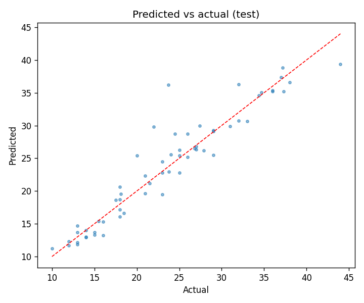

# ML Pipeline Template (AIPI 510 – Week 12)

A small, config-driven machine-learning pipeline for tabular data. Drop a dataset into
`data/raw/`, set the target column in [`config.yaml`](config.yaml), run one command, and get a
trained model, evaluation metrics, diagnostic plots, versioned artifacts and a drift baseline.
The **Results** section below is rewritten automatically after every training run.

> **Using this as a template:** on GitHub go to *Settings → General → Template repository*, or
> click *Use this template* to start a fresh repo. Then follow *Adapt to another dataset*.

## Results

<!-- RESULTS:START -->
**Test r2 = 0.8925** (validation: 0.8828, baseline: -0.0003)

- Task: `regression` | Model: `random_forest` | Run: `20261113T160957Z` | Commit: `c3339a4`
- Data: `data/raw/auto-mpg.data` (398 raw rows, 398 after cleaning, SHA-256 `48b830e11fee`)
- Split (train/val/test): 278 / 60 / 60. The test split is evaluated once, after the model is fit.
- Features used: 7

| Metric | Validation | Test | Baseline (test) |
|---|---|---|---|
| r2 | 0.8828 | 0.8925 | -0.0003 |
| rmse | 2.3984 | 2.6573 | 8.1066 |
| mae | 1.8211 | 1.7306 | 6.7100 |



<!-- RESULTS:END -->

## Dataset

**Auto MPG** (UCI Machine Learning Repository / StatLib, Carnegie Mellon University): 398 cars from
model years 1970–1982. Each row is one car model; the goal is to **predict fuel economy (`mpg`,
regression)** from cylinders, displacement, horsepower, weight, acceleration, model year and
origin. The only missing values are 6 `horsepower` entries (marked `?` in the raw file). Full
dataset card and data dictionary: [data/README.md](data/README.md).

## Quick start

```bash
python -m venv .venv
.venv\Scripts\activate            # macOS/Linux: source .venv/bin/activate
pip install -e ".[dev]"           # use ".[dev,parquet]" if your data is a .parquet file

mlpipeline prepare                # raw -> cleaned train/val/test splits in data/processed/
mlpipeline train                  # prepares automatically if needed, then trains and reports
pytest                            # code + data + model checks
```

## Data handling: no test-set leakage

1. **Raw is read-only.** `data/raw/` is never modified. `mlpipeline prepare` reads it and writes
   cleaned copies to `data/processed/{train,val,test}.csv` plus `prepare_report.json`.
2. **Clean, then split.** Duplicate rows and rows with no target are removed, identifier columns
   dropped, `?` parsed as missing. The data is then split **70% train / 15% validation / 15% test**
   (seeded, so it is reproducible).
3. **Impute after splitting, from train only.** Missing values are filled with the *training*
   split's median (numeric) or mode (categorical) and the same value is applied to validation and
   test, so held-out rows never influence the model. The fill values are recorded in
   `prepare_report.json`.
4. **The test split is read last.** Training loads only train (fit) and validation (tuning and
   feature importance). The test split is loaded once, after the model is fixed, for the final
   score. `tests/` verifies that scrambling the test labels does not change the fitted model.
5. **Stale-data protection.** The splits are regenerated automatically if the raw file or any
   `data:` setting changes.

## Adapt to another dataset

1. Commit the file to `data/raw/` (keep it immutable; add new versions as new files).
2. Edit [`config.yaml`](config.yaml): `data.path`, `data.target`, `data.read_options` (separator,
   column names, missing-value markers), `data.drop_columns` for IDs or leakage columns, and
   `data.categorical_columns` for numeric codes that are really categories.
3. Pick a model (`model.name`) – start simple (`logistic_regression` / `ridge`), then try
   `random_forest` or `gradient_boosting`. Choose between candidates using the **validation**
   metrics, never the test metrics.
4. `mlpipeline train`, then read the Results block and `reports/figures/`.
5. Update the dataset card in [data/README.md](data/README.md).

## Pipeline

```
data/raw ─► clean ─► split 70/15/15 ─► impute (train stats) ─► data/processed/{train,val,test}.csv
                                                                      │
                  train ─► preprocess + model (one sklearn Pipeline) ─► fit
                  val   ─► validation metrics, feature importance
                  test  ─► read once, after fitting ─► final test metrics vs. baseline + plot
                                                                      │
                                       versioned artifacts: models/<run_id>/ + models/latest/
                                       reports/metrics.json, results.md, baseline_stats.json
```

| Stage | Where | Notes |
|---|---|---|
| Ingest + clean | [`data.py`](src/mlpipeline/data.py) | Reader options from config; fails if the target is missing; drops duplicates, unlabeled rows and `drop_columns` |
| Split + impute | [`prepare.py`](src/mlpipeline/prepare.py) | 70/15/15 split, train-only imputation, processed CSVs, staleness check |
| Features | [`features.py`](src/mlpipeline/features.py) | Median impute + scale numerics; mode impute + one-hot categoricals (safety net for new data); drops constant, datetime and high-cardinality columns (with warnings) |
| Models | [`models.py`](src/mlpipeline/models.py) | Small registry; add a model with one line |
| Evaluation | [`evaluate.py`](src/mlpipeline/evaluate.py) | Validation and test metrics next to a majority-class/mean baseline, plots |
| Versioning | [`versioning.py`](src/mlpipeline/versioning.py) | Each run stores git commit, data SHA-256, full config, library versions and metrics beside the model |
| Monitoring | [`drift.py`](src/mlpipeline/drift.py) | Population Stability Index per feature (<0.1 stable, <0.25 moderate, else significant) |
| CI | [`.github/workflows/ci.yml`](.github/workflows/ci.yml) | Ruff + pytest on every push |
| Packaging | [`Dockerfile`](Dockerfile) | `docker build -t mlpipeline . && docker run mlpipeline` |

## Using the trained model

New data should be a CSV with a header row and the same feature column names as the processed data.

```bash
mlpipeline predict --input <new-data-file> --output reports/predictions.csv
mlpipeline drift   --input <new-data-file>     # PSI vs. training distribution
```

## Project layout

```
config.yaml            all dataset/model settings
data/raw/              immutable input data
data/processed/        cleaned train/val/test splits + prepare_report.json (generated)
data/README.md         dataset card and data dictionary
src/mlpipeline/        pipeline code (cli, config, data, prepare, features, models, evaluate, drift, ...)
tests/                 pytest suite running on synthetic data
reports/               metrics.json, results.md, figures/, drift baseline  (committed)
models/                versioned model artifacts (git-ignored)
```

## Notes and limitations

_TODO: discuss what the model gets wrong (see the predicted-vs-actual plot), the small test set
(60 rows, so the test score is noisy), and what you would try next with more time._